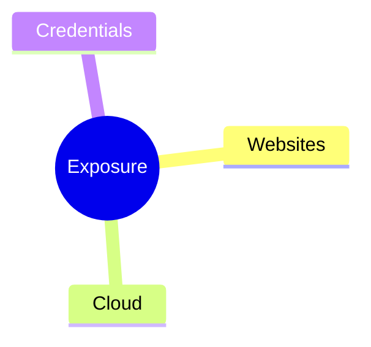

# documentor

Take a document somebody already wrote and re-issue it as a well-typeset
one — or, for a commercial proposal, assemble one from a data file and a
template. Re-issuing is still the main thing this tool does; proposals are
the one case where the document does not exist yet.

```bash
documentor build report.md --to pdf
```

The result lands beside the input as `report.plain.pdf`. Pass `--to docx` for
a Word file instead — `report.plain.docx`, built from the same intermediate
representation as the PDF, so the two cannot drift apart:

```bash
documentor build report.md --to docx
```

## Getting it

Check "Requirements" below first. documentor isn't on npm yet. Each version
tag publishes a ready-built package on the repository's Releases page, and
this installs the newest one:

```bash
npm install -g https://github.com/4aykas/documentor/releases/latest/download/tebin-documentor.tgz
documentor build report.md --to pdf
```

That is the whole install. The first command that writes a PDF notices the
Chromium build this copy launches is missing, says so, installs it (one
time, about 150 MB) and then builds. Two commands exist for doing that
ahead of time and for finding out what else is missing:

```bash
documentor setup      # installs that Chromium now, before any document
documentor doctor     # checks everything a build needs, names the fix for each miss
```

If anything stops a run — Node older than 22, a Chromium download that a
proxy blocked, a font Word needs — the message names what is missing and
the command or download that fixes it. `doctor` repeats all of it in one
place.

Use `documentor setup` for the browser, not `npx playwright install
chromium`. npx installs the Chromium build of whatever playwright release is
newest. That build is not the one documentor's pinned `playwright-core`
looks for, so doctor then reports a browser that "does not exist".

To update, run the same `npm install -g` line again, then `documentor setup`.

Don't use `npm install -g github:4aykas/documentor`. npm builds a git
dependency in a clone with its global flag still set, so TypeScript never
reaches that clone and the build fails with `'tsc' is not recognized`. The
release package is already built. A local, non-global
`npm install github:4aykas/documentor` inside a project does work.

**In Claude Code**, the skill that drives the CLI installs from this
repository too:

```
/plugin marketplace add 4aykas/documentor
/plugin install documentor@documentor
```

The skill runs `inspect`, asks only the questions that change the output,
writes the sidecar and builds. It does not install the CLI itself. On a
machine without the CLI it gives these same three commands.

**Fonts in Word.** A PDF carries its fonts inside it, so it looks the same
everywhere. A `.docx` names its fonts and leaves drawing them to Word. The
`schweiz`, `tebin-schweiz` and `tebin-ua-schweiz` themes use Manrope and
JetBrains Mono, `haskoning` uses Urbanist, `dreamscape` uses Manrope,
Pixelify Sans and JetBrains Mono, and `blueprint` uses JetBrains Mono, all
free on Google Fonts. Install them where the Word files will be opened, or
Word substitutes a serif. The `plain` and `tebin` themes
use Arial, which every machine has.

From a clone, `npm install` and then `npm run documentor -- build report.md`
runs the same code without installing anything.

## What it does

`documentor` builds a small, format-agnostic representation — from a source
document it reads, or, for a proposal, assembled from a data file and a
template — then draws that representation with a theme. The look lives in
one place, so a PDF and a Word file made from the same representation cannot
drift apart.

## What it reads and writes

| from ↓ &nbsp; to → | PDF | Word `.docx` | Markdown | Excel `.xlsx` |
|:--|:--:|:--:|:--:|:--:|
| **Markdown `.md`** | yes | yes | yes | — |
| **Word `.docx`** | yes | yes | yes | — |
| **Excel `.xlsx`** | yes | yes | yes | — |
| **PDF** | yes | yes | yes | — |

This table is about re-issuing a single existing source. Proposals sit
outside it: `documentor proposal` takes two inputs, a data `.json` file and
a `.md` template, and writes PDF, Word or Markdown from the pair — see
"Proposals" below.

Markdown out is not a second design — it is the intermediate representation in
a form a human reads, which makes it the cheapest way to see what an ingester
understood.

Three limits are worth knowing before you rely on them, because all three are
deliberate rather than unfinished:

- **Reading `.xlsx` serves small tabular registers, and refuses the rest.** A
  merge confined to one row is flattened — the value moves to its leftmost
  cell and the flattening is reported by range — because that is what the
  sheet already shows a reader; a merge that spans more than one row is
  refused by name, because a table has no way to express which rows it
  grouped, and flattening one would look right while saying something the
  source did not. So is a sheet past 200 rows or 25 columns, which is a limit
  on what a person reads on paper rather than on what the code can build.
  Expect this to still refuse most working spreadsheets — over a real set of
  68, it read 22. The message names the sheet and the number, so it tells you
  which range to extract and re-issue instead.
- **Reading `.docx` carries paragraphs, headings, lists, emphasis, links, page
  breaks and PNG, JPEG, GIF and BMP images. It does not carry tables** — it
  reports them instead, by size, so a lost table is loud rather than silent.
  Nothing else is silently dropped either: comments, tracked changes,
  footnotes, text boxes and the old letterhead are all named in the run's
  report.
- **Reading a PDF serves a document whose tables are drawn, and is honest
  about everything else.** A PDF has no structure — positioned glyphs and
  drawn paths, no headings and no cell boundaries — so everything is
  inferred. Portrait and landscape pages both read; a single-column page's
  paragraphs and headings come back, heading level taken from the
  document's own size distribution rather than a theme (a PDF with no size
  contrast has no heading structure to recover, and says so). The size
  distribution is computed over the WHOLE document, table cells included —
  in a table-dominated document (a financial statement, say) the modal size
  is the table body's own, often smaller than ordinary prose, so an
  ordinary sentence set at a perfectly normal size can come back promoted to a
  heading merely for being larger than the table's own dense cell text; a
  document that reads as flat prose everywhere still needs a look before
  trusting every heading it grew. A table is
  read only from the rectangles the page actually draws — its grid, every
  cell abutting the next, never from where the text merely lines up:
  clustering text by position would read an unruled table, and would, now
  and then, misread a two-column page as one. A table split by a page
  break joins back into one.

  Two different things happen to what falls outside that. An image and a
  run of rotated text are each *excluded and reported* — what it was, how
  many, and where — the same way a dropped `.docx` table is. Multi-column
  text and a table with no rectangle-drawn grid at all (including one
  drawn only as disconnected thin rules, with no cell actually abutting the
  next) are not excluded and not named individually: their text is kept,
  simply read in reading order as ordinary paragraphs rather than
  reconstructed into a table or columns it cannot prove. That is a
  deliberate fallback, not a bug — clustering text into a grid the page
  never drew is exactly the guessing this reader refuses to do — but it is
  a quieter outcome than "refused," and worth knowing before you rely on a
  table coming back as a table. Forms and annotations are not part of what
  this reader looks at: page geometry here is drawn paths and positioned
  text only, so form-field and annotation content, if any, is outside what
  it sees at all.

  What keeps the rest honest is a check no other reader here needs: the
  source's own text and the assembled document's text are compared token by
  token after ingestion, and any difference refuses the whole build, naming
  the first divergence — a value in the wrong column is the failure worth
  fearing, because nothing about the output would otherwise say so. A page
  count past the limit and a page that draws past its rectangle cap are
  refused by name too, each naming the count and the limit.

  Page furniture (a letterhead, an address block, a running footer) is
  **declared, never inferred.** With nothing declared, nothing is removed —
  instead the run reports every repeated block it found, with the y-value
  that would drop it. Write those two numbers into the input's
  `<name>.documentor.json` sidecar as `"pdfChrome": { "dropAbovePt": …,
  "dropBelowPt": … }` and rerun; there is no command-line option for this —
  the sidecar is where a fact discovered from one run's own advisory
  belongs. One manual step per document *shape*, not per document, in
  exchange for the guarantee that this reader never deletes a line it only
  suspected was furniture.

  **`documentor` cannot usefully read back its own rendered PDFs.** Its
  table CSS draws one bottom border per cell — disconnected thin rules,
  with no cell actually touching the next — which is exactly the grid-less
  shape described above. The build itself does not fail: every cell's text
  survives, in row-major reading order, but as flat paragraph lines rather
  than a table, because nothing on the page proves where one column ends
  and the next begins. That is a known, accepted gap, not a bug to fix
  here: re-issuing a PDF `documentor` itself produced is not a use case
  this ingester serves, and a table that came back would look badly broken
  either way.
- **A table's columns are sized from their content, by one solver both
  renderers call** (src/render/table-width.ts). Widths are proportional to
  what each column actually carries, with a floor so a one-character column
  is still a column and a ceiling so one verbose column cannot swallow the
  table. The two used to answer this separately — Word computed it, the PDF
  left it to Chromium — and the same register wrapped to a second line in one
  and left a wide unused strip in the other.
- **A table too wide for the portrait text column is printed on a landscape
  sheet of its own**, in both formats, and only that table: the page turns
  back for whatever follows. "Too wide" means the columns cannot each have a
  readable minimum, not merely that the text wraps. In Word that means the
  body is cut into sections, because orientation is a property of a section
  and not of a block.
- **A table with no header row is a list of labelled values, not a grid.**
  Markdown cannot say "this table has no header", so a template writes an
  empty header row — which makes the intent unambiguous. Such a table drops
  its row rules, mutes the label column, and hugs the left instead of being
  stretched across the page, so a label sits beside its value rather than at
  the opposite end of an empty gap.
- **Writing Word embeds a PNG, a JPEG, a GIF or a BMP** — the same four reading
  a `.docx` carries, so a `.docx` in gives you every picture back in the
  `.docx` out. A picture needs its natural proportions, and those come from
  reading the file, so anything else becomes a visible placeholder naming what
  it was. That includes SVG, whose Word support is version-dependent and which
  would need a raster shipped alongside it that cannot be produced
  reproducibly, and WebP, which Word's own file format has no content type for.
  The PDF path embeds any raster.
- **A cover page reaches Word intact, except for one measurement it cannot
  compute.** On a cover (`meta.cover: true`) with two or more `rule` blocks,
  both renderers draw the same three zones (see src/render/cover-zones.ts):
  the hairline-bordered panel at the top, the brand's corner mark seated in
  the panel's top-right corner, and the blocks after the last rule pinned to
  the page's bottom margin — in Word through a `w:framePr` text frame, which
  a reader that ignores it simply renders in normal flow. What does not carry
  is the statement band's vertical centring: the PDF gives the band the
  flowing zone's slack through an auto margin, and Word, having no
  page-relative box for growing content, gets a fixed gap above and below
  instead. The band is a little higher on the Word page than on the PDF one.

## Diagrams

A ```` ```mermaid ```` fence in a Markdown source is drawn, not printed as code,
by [Mermaid](https://mermaid.js.org); a ```` ```chart ```` fence is a bar,
grouped bar, dumbbell or waterfall chart drawn by documentor itself from the numbers the
author wrote ([`docs/diagrams/chart.md`](docs/diagrams/chart.md)); an
```` ```axonometric ```` fence is an exploded view or a floor plan seen from
above at an angle, drawn from the geometry the author declared
([`docs/diagrams/axonometric.md`](docs/diagrams/axonometric.md)). These types
are drawn in the theme's own colours and proofed in every theme; another type
Mermaid knows is drawn with the shared settings only.

| Type | Fence | Header |
|:--|:--|:--|
| Flowchart | `mermaid` | `flowchart` |
| Sequence | `mermaid` | `sequenceDiagram` |
| Class | `mermaid` | `classDiagram` |
| State | `mermaid` | `stateDiagram-v2` |
| Entity relationship | `mermaid` | `erDiagram` |
| Mind map | `mermaid` | `mindmap` |
| Timeline | `mermaid` | `timeline` |
| Gantt | `mermaid` | `gantt` |
| Pie | `mermaid` | `pie` |
| Quadrant | `mermaid` | `quadrantChart` |
| XY chart | `mermaid` | `xychart-beta` |
| Journey | `mermaid` | `journey` |
| Sankey | `mermaid` | `sankey-beta` |
| Git graph | `mermaid` | `gitGraph` |
| Block | `mermaid` | `block-beta` |
| Bar chart | `chart` | `bar` |
| Grouped bar | `chart` | `grouped` |
| Dumbbell | `chart` | `dumbbell` |
| Waterfall | `chart` | `waterfall` |
| Exploded axonometric | `axonometric` | `exploded` |
| Axonometric plan | `axonometric` | `plan` |

Why they look the way they do is recorded in [`docs/adr/`](docs/adr/README.md).

````markdown

````

- **One grey system, one accent.** Every colour comes from the theme's
  sheet, ink and brand. Structure is ink mixed into the sheet at fixed
  strengths — a box 3.5%, its outline 22%, a line 50%, secondary text 62%,
  the scheme beautiful-mermaid derives its themes from — and the brand is
  spent on what carries direction or emphasis: arrowheads, the first
  series, a highlighted point. A mind map, timeline or pie runs one hue from
  the brand toward the sheet; series in a chart, a sankey or a git graph
  step through the brand and neutrals that differ in lightness. Edge labels
  sit on small chips in the secondary ink. Labels are set in the theme's
  body face, wrapped to two or three lines; a long sequence message wraps
  between its lifelines.
- **Where Mermaid ignores a theme, the drawing is corrected.** A sankey's
  fixed colour scheme and a journey's actor colours (read before any
  configuration applies) are repainted after drawing, a quadrant chart's
  point colour is named instead of the `hsl(0, 0%, NaN%)` Mermaid derives,
  a gantt axis is thinned to about nine dates, and a pie or quadrant chart
  is held to part of the column instead of filling it.
- **Labels at the body size.** A diagram is laid out at the theme's body
  size, so the scale it needs to fit the column is the size its labels print
  at. A left-to-right flowchart or timeline that would shrink below that is
  drawn top-down when that prints larger, and the build says so; anything still
  scaled below three quarters of the body size gets a warning naming the
  size. The words are never changed, only the layout. documentor's own
  charts and axonometric figures are laid out at the column's width and the
  body size, so they never scale.
- **ELK on request.** Flowcharts use dagre. A diagram whose own frontmatter
  says `layout: elk` is laid out with ELK instead, for orthogonal edges and
  aligned rows, which suits architecture drawings.
- **The same picture in every format.** PDF inlines the SVG, so a label is
  text a reader can select and search; Word embeds a PNG of that SVG at
  three times its size; Markdown writes the fence back verbatim, and reading
  it in again gives the same source.
- **Drawn offline.** Mermaid runs inside the Chromium the PDF already uses.
  Its modules load from `https://documentor.invalid`, an origin that cannot
  resolve, answered from the installed packages; every other request is
  refused. A Word-only build of a document with a diagram launches Chromium
  for that reason.
- **A fence that cannot be drawn stays its source.** It prints as a code
  block, and the build warns which diagram it was and why: what Mermaid's
  parser said, or the line of a chart or a figure that could not be read, did
  not add up, or could not stand.
- **Never wider than the column.** A diagram is scaled down to the text
  column and to most of a page's height, never cropped.
- **Described by the author.** A Mermaid fence's own `accTitle:` and
  `accDescr:` (a line, or an `accDescr { … }` block), or a chart's or a
  figure's `title` and `desc`, stay in the SVG as its title and description for screen readers,
  and become the picture's alt text in Word.
  A diagram without them is named in Word by its type only; `inspect`
  counts it under `undescribedDiagrams`. PDFs are not tagged yet
  (`docs/adr/0007`).
- **One focus, marked by the author.** A node marked `:::focus` (in a state
  diagram, `class X focus`) is outlined in the brand on a faint brand fill.
  Two at most: the accent reads only when it is kept for what the diagram is
  about. In a chart or an axonometric figure, `focus` ends a row or an
  element line, one at most.
- **Every drawing is checked, and a finding warns.** After drawing, each
  diagram is measured as the browser lays it out, and the build warns with a
  code: `D-SMALL` labels print below three quarters of the body size (with
  advice for what binds, the column or the page height), `D-COLLIDE` two
  labels overlap, `D-COVER` an edge label sits on a box or a chart's label on
  a bar, `D-CROSS` an edge runs through a box or a label it does not belong
  to, `D-CLIP` a label runs
  past the drawing, `D-BUDGET` more nodes, edges, lifelines or tasks than the
  type reads well with, `D-FOCUS` more focus marks than the type allows, `D-UNRECORDED` a
  Mermaid type documentor does not proof. A finding never changes the
  drawing or fails the build.

## Proposals

`documentor proposal <data.json>` assembles a commercial offer from two
inputs: a data file holding the facts of this one offer (project, team,
rates, hours, the sections written fresh each time) and a markdown template
holding the skeleton and the boilerplate. Every sentence in the output comes
from one of the two, verbatim — the command assembles, it does not write.

The budget is computed, never typed: hours × rate per role, summed, printed
as `€ 4 500,00`. A summary line marked `"covers": "budget"` must equal that
total or the build fails quoting both figures. The involvement heatmap is
drawn from the same team array (`{{@heatmap style=scale|numbers|marks}}`,
`scale` by default), and a deliverables register named by `"annex"` joins as
an annex through the spreadsheet reader — with its row cap raised to 2000 for
this one path, because a reference register is searched, not read.

Two generic examples ship to copy from: `templates/offer.example.md` for a
proposal that starts straight into its sections, and
`templates/proposal-cover.example.md` for one that opens with a cover page —
the same file, plus the zones, the statement band and the labelled-value
block described below. Its data file must set `"cover": true`; `templates/proposal-cover.example.json`
is one, and both ship, so `documentor proposal` runs on the pair as installed. A real template carries a
company's own commercial terms and belongs outside a public repository, the
way this repository keeps its own brand book out of git.

### Bilingual contracts

`documentor contract <data.json>` assembles a contract the same way, from its
own data model. A contract is a different document from a proposal, not a
proposal with different words: it has no team, no rates and no budget, and
what it does have is a numbered clause structure printed in two languages at
once. Forcing one model to carry both would mean inventing a team for a
document that has none — exactly what `documentor proposal` refuses to let
anyone do.

The data file holds the parties, and articles each carrying their clauses,
every one of them as a `{ uk, en }` pair. Both languages are required
throughout: the two columns are equally authentic versions of the same
obligation, not an original and a translation, and a bilingual contract
printed with one column blank is not a tidier contract — it is a contract
with a hole in it, and which half is missing is what nobody notices until it
is signed. A dotted clause number that does not sit under its article's is a
build error naming both, since every cross-reference to either would then be
wrong.

Articles arrive through `{{@articles}}` rather than a loop, because this
template language has none by design. Each one prints as a heading of its own
followed by its own two-column table — not as rows of a single table spanning
the whole document, which repeats the language header on every page, flattens
articles and clauses into one undifferentiated list, and lets a page break
fall anywhere. `{{@parties}}` and `{{@signatures}}` print the other two
bilingual blocks.

`templates/contract-ua.example.md` and `templates/contract-ua.example.json`
ship as a pair to copy from, so `documentor contract` runs on them as
installed. Their prose is placeholder; a real contract's wording is the
company's own and belongs outside a public repository.

**On a cover page (`meta.cover: true`), a template's `rule` blocks lay out
the page.** The first `rule` closes a bordered panel holding the title and
everything above it; the last `rule` opens a foot holding everything below
it — one at the top, one at the bottom, and whatever falls between flows as
ordinary content. No `rule` at all leaves the cover as plain flow, title then
blocks, unchanged from before this existed. Exactly one `rule` gives you a
panel and nothing to pin against, so only the panel appears. Two or more is
what produces all three zones. Word pins the foot to the page bottom too,
through a text frame.

**A blockquote between those rules becomes the cover's statement band** — a
tinted brand panel with the first line set as large display type, dropped
into the middle of the page by giving it the zone's slack, half above and
half below. It exists because the middle of a cover is otherwise empty, and
a page that is a panel, four lines and an address reads as unfinished. Its
text is still the template's own, verbatim: this is a place to put a
sentence, not a sentence documentor writes. Elsewhere in a document — and on
a cover with no rules — a blockquote stays a blockquote. Word draws the same
band, with a fixed gap above and below rather than centred: the PDF centres
it by handing it the zone's slack, and Word has no slack to hand out.

Two more things this refuses rather than fakes. **The corner mark does not
bleed off the PDF's page corner.** The real offers show the brand glyph in
the very corner of the sheet; Chromium clips a page's content to the content
box, and the print margin is where the running header lives, so page content
cannot paint there. An offset large enough to look like a bleed put the glyph
entirely outside the page — and, because the overflow made the layout wider
than the sheet, made Chromium shrink the whole cover about 9% to fit. The
mark is seated in the panel's own top-right corner instead, overlapping
inwards — which is where the real offers put the second of their two marks
anyway — and Word seats it in the same corner, so the two renderers agree.

**And the mark reaches Word as a raster derived from its vector, not as a
second vendored file.** Word cannot be relied on to draw an SVG, so it needs
a PNG; a PNG vendored beside the SVG drifted from it, silently, and printed a
glyph whose vertical bar stopped short of the corner. `npm run theme:tebin`
now rasterises `corner-mark.svg` through the same Chromium that prints the
PDFs. Do not re-vendor a raster.

`documentor inspect <data.json>` reports what would be assembled — the
title, the team, the computed budget total, every validation error — and
writes nothing.

## The decisions live in a file, not in a conversation

A build's decisions — the title, the date, the entity on the letterhead, the
theme, which formats to write — go in `<name>.documentor.json` beside the
source, and are picked up automatically:

```json
{ "title": "Q3 Review", "date": "July 20, 2026", "theme": "tebin", "to": ["pdf", "docx"] }
```

A month later the same command reproduces the same bytes with nobody
remembering anything, and a year later the diff says why the document looks
the way it does. That is the whole point: a decision that lives only in
somebody's memory of a conversation is a decision already lost.

`"reference": "TN-2026-014"` there gives the document its own number. It
prints beside the letterhead with the entity and the date, between the two,
and appears only when the sidecar sets it.

`"cover": true` there opens the document with a cover page rather than the
theme's ordinary first-page letterhead, and the source's `rule` blocks lay
that page out — the same three zones a proposal cover uses, described under
"Proposals" above. It is a sidecar key and not a flag for the same reason
`pdfChrome` is: whether a document opens with a cover is a fact about the
document, not about the invocation.

A flag on the command line outranks the sidecar, which outranks whatever the
document says about itself — the order in which each was deliberately decided.
`--config <file>` names one explicitly, `--no-config` ignores it. An unknown
key is refused by name rather than skipped, because a typo that quietly does
nothing would let you believe a decision was recorded when it was not.

## Reproducible by construction

The same input produces byte-identical output on the same platform:

- timestamps come from `SOURCE_DATE_EPOCH` or the input file's mtime, never the
  clock;
- the font is embedded, not resolved from the system, so a machine without
  Arial does not silently re-wrap every line;
- the renderer fetches nothing — CSS, fonts and logos are inlined before the
  browser sees the page.

Output may still differ between platforms, because the renderer does: PDFs are
drawn by Chromium, and Chromium's build, its text shaping and its rasteriser
are not identical on Windows, macOS and Linux. That is why the visual baseline
images in this repository are pinned to one platform. Reproducibility here
means "the same machine, twice", which is what a rebuild a year later actually
needs; it is not a promise of a byte-for-byte match across operating systems.

## Themes

The default theme, `plain`, carries no brand. A theme is one JSON file:

```bash
documentor build report.md --theme ./my-brand/theme.json
```

See `themes/plain/theme.json` for the shape.

### A theme modelled on a design you like

`schweiz` is modelled on a Swiss agency's site. It uses black type, heavy
geometric headings, and small uppercase monospace labels. It was made in two
steps, and any other theme is made the same way:

```bash
documentor theme capture https://www.rosarot.ch/agentur --name schweiz
```

The first step measures the page in the same Chromium that prints the PDFs.
It records the faces the page actually paints, with their sizes, weights and
colours, weighted by how much text each carries, and writes that record to
`.input/captures/schweiz/` together with a screenshot. It writes no theme.
In the second step a person reads the capture beside the screenshot and
writes `themes/<id>/theme.json`. The most frequent colour on a page is
usually its body text, not its brand, so this step is not automated.

`haskoning` is the second theme made this way, modelled on an engineering
consultancy's site: a cream sheet, dark navy type and rules, a teal accent,
bold geometric headings in Urbanist and small uppercase labels with a little
tracking. It uses none of the company's artwork — its corner mark is an
arrow cut out of a filled square, after the site's own button furniture.
Two things it needed that `schweiz` did not, and any theme may now use:

- `colors.paper` colours the sheet itself. The PDF lays that colour under
  every page, margins included; Word is handed it as the document
  background, which Word shows on screen and prints only if the reader's
  print settings say so. A mark may paint in it through the `c-paper`
  class, the way a glyph cut out of a filled square shows the sheet.
- A face without Cyrillic of its own may name a stand-in. Urbanist is Latin
  only, so `render/fonts.ts` inlines Manrope's Cyrillic beside it and names
  Manrope next in the family stack: a Ukrainian word falls to a chosen
  face, never to whatever the reader's system has.

A theme can give three roles a face of their own:

```json
"font": {
  "document": "Manrope", "embed": "manrope",
  "heading": { "document": "Manrope", "embed": "manrope", "weight": 800 },
  "label": { "document": "JetBrains Mono", "embed": "jetbrains-mono", "uppercase": true }
}
```

`label` covers the letterhead lines, table header cells and the running
header. A site's own faces are almost always commercial, so `embed` names a
free face that reads the same way: `arimo`, `manrope` or `jetbrains-mono`,
each inlined into the PDF with Latin and Cyrillic. Word embeds no fonts. A
`.docx` names the same families and looks right only where they are
installed; anywhere else Word substitutes its own.

### Designed layouts

A theme sets colours and faces on the ordinary page. A layout replaces the
page itself with one drawn by hand from a single designer's or house's
language. Seven themes come with one:

```bash
documentor build approach.md --theme rams --to pdf
documentor build approach.md --theme rodchenko --to pdf
documentor build approach.md --theme haskoning --to pdf
documentor build approach.md --theme dreamscape --to pdf
documentor build approach.md --theme blueprint --to pdf
documentor build approach.md --theme lionfocus --to pdf
documentor build approach.md --theme lionfocus-light --to pdf
```

- **`rams`**, after Dieter Rams. The cover is a Braun front panel: a speaker
  grille, a tuning wheel, one coloured switch, and a tuning scale whose
  stations are the document's gates. Inside there is one grid: a label column
  with each section's number and name, a text column in one quiet size,
  hairlines, and a single orange accent.
- **`rodchenko`**, after Alexander Rodchenko. The cover is a poster: a red
  circle, the title on a diagonal band, and the cover's lines on rays from a
  megaphone, after *Books!*. Each section opens with a black girder and a
  large red number. Tables have black rules, bullets are arrows, and gates
  climb a staircase.
- **`haskoning`**, in the language of haskoning.com. A navy hero band sits
  under a drawn bathymetric chart. Sections alternate sky and mint, list
  items are rows ending in an arrow, gates sit on a navy band, and the close
  is navy under a teal strip. No logo or photograph of the company is used.
- **`dreamscape`**, after a contemporary-art exhibition identity built from
  generated dreams. The cover is a full-bleed picture drawn from the title:
  discs that step round into a spiral or sink into a tunnel, in a sunrise
  ramp from indigo through magenta to orange. The title is set in a pixel
  face, and the document's own words become snake_case keys and
  `[ bracketed ]` tags in a monospace. Each section opens on its own dream
  band. Statements, gates and the close sit in black panels with thin
  outlined boxes, and the gates are rings round one centre. The same title
  always draws the same picture. No artwork, mark or name of a museum or
  agency is used.
- **`blueprint`**, a sheet of a drawing set. Pages are A4 landscape inside
  a double frame with grid-reference zones (1–8 across, A–D down) and
  centring marks. Every sheet, the first included, carries a title block
  with the TEBIN logo, the document's title, subtitle, number and date, and
  the sheet number out of the total. The cover sheet draws the document's
  sections as a chain dimension with a numbered bubble each and lists them
  beside it. Inside, sections open on a detail bubble and second-level
  headings hang in the left column. Tables are schedules, bullets are
  dimension ticks, numbered items sit in bubbles, a quote is a boxed note
  under a revision triangle, and gates stand on a dimension line. TEBIN red
  is the one accent; codes and labels are set in JetBrains Mono.
- **`lionfocus`** and **`lionfocus-light`**, in the language of
  lionfocus.ai, one layout on a near-black sheet (the site's default) and on
  white. The cover is a radar scope drawn from the title on a magenta
  graph-paper grid: rings, a tick ring, a fading sweep, and blips, the
  brightest three in reticles. The title is set in JetBrains Mono in two
  tones, split at its colon, with an index of the sections beside the scope.
  Sections open on a number in corner brackets over a magenta rule.
  Numbered steps are joined by a line, diagrams and code sit in cards with
  corner brackets, and quotes and the close are a magenta gradient band
  standing on diagonal hatching. Body in Inter. No logo, photograph or
  illustration of the company is used.

A layout places the document's own blocks and writes no text. A
`meta.cover` document (`"cover": true` in the sidecar) gets the full cover.
Its title, its panel lines, the key-value table, the quote, and the lines
between and after the rules each go to a fixed place on that page. A
document without a cover opens with the layout's first page instead.
Top-level headings become sections; in a document whose only `#` is its
title, the `##` headings do. A heading's own leading number ("1.")
is set apart as the section number. When no heading has one, the layout
numbers the sections itself.

One table is drawn as a figure. That is a table of two to eight rows whose
first column is a run of gate codes such as G0, G1 or M1. It becomes the
gate figure, with every cell and the header row carried. When one column
holds a month and year for every row, the gates are placed in time.

Three things a layout does not do:

- **No layout in Word.** A `.docx` gets the ordinary page in the theme's
  colours and faces, because a designed page in Word would be a picture of
  one.
- **A4 only.** The covers are drawn for that sheet, upright, except
  `blueprint`, which turns it landscape.
- **Some lines change case on the page.** `rams` sets an all-capitals source
  line in sentence case, `rodchenko` sets its band and rays in capitals, and
  `dreamscape` repeats section titles and its cover's first line as
  capitalised snake_case keys.
  The text in the file is unchanged; only how it is drawn differs, so a copy
  out of the PDF may differ in case from the source.

The suite checks that every word of a document reaches each layout's page.

### Looking at a whole PDF at once

```bash
documentor proof approach.rams.pdf            # approach.rams.proof.png beside it
documentor proof approach.rams.pdf --cols 5 --width 240 --out sheet.png
```

`proof` lays every page of a PDF side by side on one PNG, numbered, so a
layout is checked in one look rather than page by page. It draws the pages
with the same PDF engine documentor reads PDFs with, inside the Chromium it
prints with, so it needs nothing else installed.

### A diagram on its own

```bash
documentor diagram chart.md                   # chart.svg beside it
documentor diagram chart.md --theme tebin --width 400 --out figure.svg --png figure.png
```

`diagram` draws the first ```` ```mermaid ````, ```` ```chart ```` or
```` ```axonometric ```` fence of a Markdown file as a standalone SVG, for a
figure that goes somewhere other than a documentor document: a post's image,
a slide. It runs the same checks a build does and prints their warnings.
`--width` lays the diagram out to a column of that many points instead of the
theme's own; a narrower column draws the text larger relative to the figure,
for a picture shown bigger than a page column. Exit codes: 0 drawn clean;
1 drawn, with a `D-` finding; 2 a usage error or no fence; 3 the fence was
refused, and nothing is written. Another repository should call this
command rather than import documentor's source.

### Refreshing the TEBIN brand theme

`themes/tebin/theme.json` is generated, not hand-edited. Its only input is
`brand/tebin/`, vendored from the `tebin-style` design system rather than
fetched, so the generator runs offline and a brand refresh is an explicit
commit whose diff shows what moved. To pull in a brand change:

1. Replace the files under `brand/tebin/` from the same source (see
   `brand/tebin/SOURCE.md` for what that source is and what each file is for).
2. Run `npm run theme:tebin`.
3. Commit `brand/tebin/` and the regenerated `themes/tebin*/theme.json`
   together.

The same run writes `tebin-schweiz` and `tebin-ua-schweiz`. These set TEBIN
in the `schweiz` manner: Manrope, uppercase monospace labels and black
hairlines. The wordmark and the corner glyph are traced in a red hairline
instead of filled. The outline is computed from the vendored vectors: the
glyph's two bars become one L. On a cover it sits on the panel's corner, so
the frame turns red where it meets the mark. A theme can ask for that kind of
drawing in two places. A mark's paths can use the classes `c-line`,
`c-line-muted` and `c-line-ink`, which stroke in the brand, muted and ink
colours at one hairline weight at any size (see `src/render/line-mark.ts`).
`"coverStatement": "line"` sets the cover's statement off with a hairline
instead of a tinted fill.

`"masthead": "grid"` gives an ordinary document's first page a different head.
The Swiss TEBIN themes ask for it. Instead of the classic band (logo left,
letterhead ranged right, brand tick below), the letterhead is set as four
equal columns, each numbered and each under its own length of hairline, so
the gutters break the rule:

1. The logo.
2. The issuer: name, then the address split at each comma.
3. The contact and registry lines, split at each `|`.
4. The document's own number (`reference`) and date, with the date set strong.
   The entity is not printed here, because column 2 already names the issuer.

An empty column is dropped and the numbers close up. Numbers stand in for
captions because a caption would have to be translated, and a number reads
the same in every language. The grid continues through the title band:

- The corner mark stands in column 01, under the logo.
- The title and subtitle hang from column 02's edge, set between h1 and cover
  size.
- A hairline across columns 02–04 closes the band.

Word draws the columns in its first-page header and hangs the title the same
way. It anchors the mark to the title paragraph, so the two move together
when someone edits above them. The default is `"band"`.

## Requirements

| What | Needed for | How to get it |
|:--|:--|:--|
| **Node.js 22 or newer** | Everything | [nodejs.org](https://nodejs.org), the LTS installer. It includes npm. |
| **Internet access** | The install, and `documentor setup` once (about 150 MB of Chromium) | After that, builds run offline. |
| **Chromium** | Every PDF, and reading a PDF | `documentor setup`. On Linux, `documentor setup --with-deps` also installs the system libraries Chromium needs. |
| **Manrope and JetBrains Mono** | Only `.docx` files from `schweiz`, `tebin-schweiz` and `tebin-ua-schweiz`, opened in Word | Free on [fonts.google.com](https://fonts.google.com). Install them on each machine that opens those Word files. PDFs don't need them. |
| **Urbanist** | Only `.docx` files from `haskoning`, opened in Word | The same, from the same place. |
| **Pixelify Sans** | Only `.docx` files from `dreamscape`, opened in Word, with Manrope and JetBrains Mono | The same, from the same place. |
| **Microsoft Word** or another `.docx` reader | Opening Word output | Not needed to build it. |
| **Claude Code** | Only the skill | See "Getting it" above. |

Everything else ships inside the package. That covers the other npm
dependencies, the fonts embedded in PDFs, and the themes with their logos.

`documentor doctor` checks all of this and names the command that fixes
whatever is missing. Run it first when something behaves oddly. A missing
Word font shows as a `note`, not a failure, because it changes how Word
draws a file, not whether documentor can build it.

## License

MIT. See `LICENSE`.
