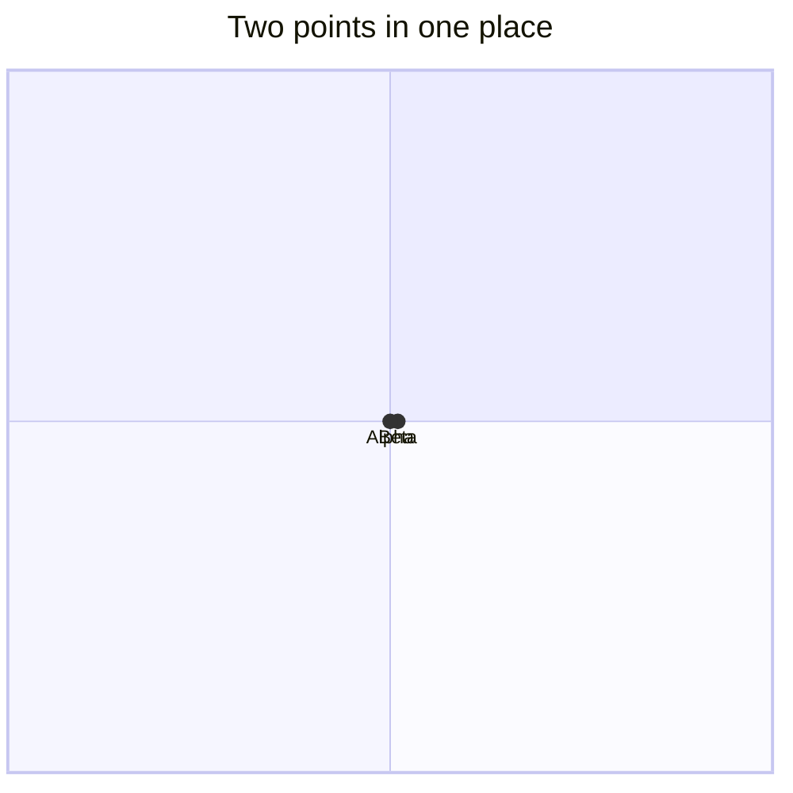
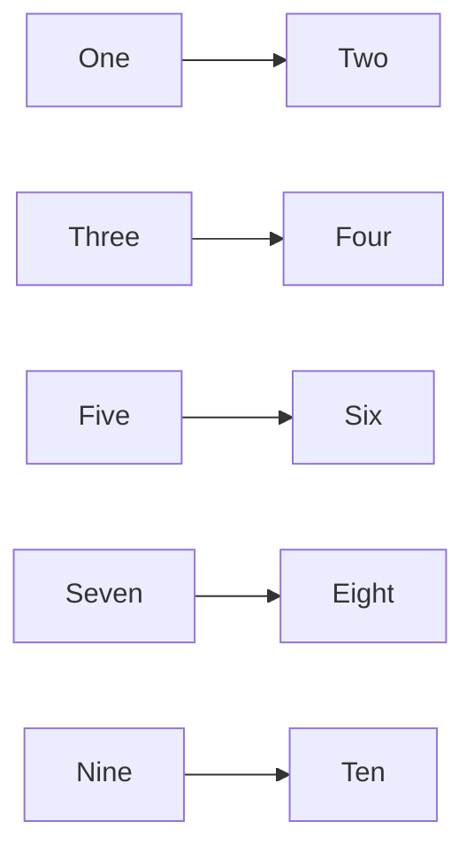
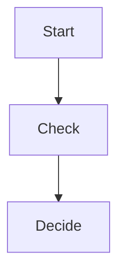
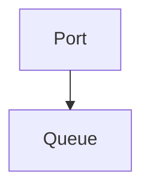
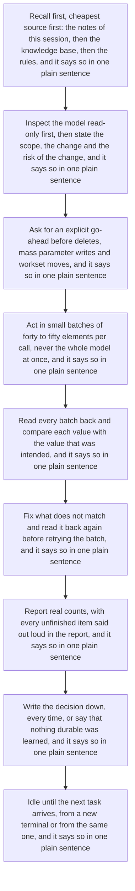

# Diagram faults

One diagram per finding Mermaid can be made to produce, headed with the code
it must raise and nothing else (test/render/diagram-checks.test.ts).
D-CLIP and D-COVER have no reliable Mermaid reproduction; their rules are
tested on synthetic boxes.

## D-COLLIDE

## D-BUDGET

## D-FOCUS

## D-UNRECORDED

## D-SMALL

