# Diagram gallery

Every Mermaid type documentor draws, one per section.

## Flowchart

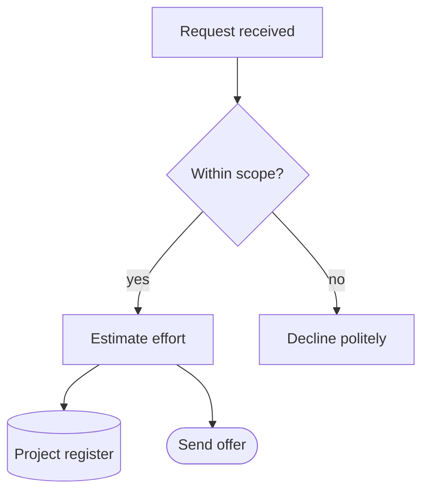

## Sequence

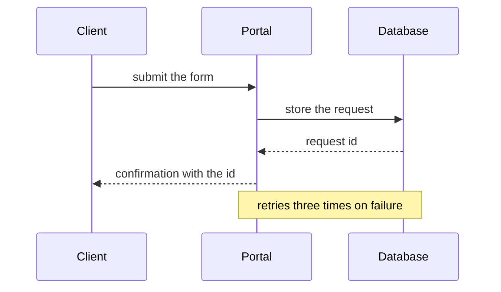

## Class

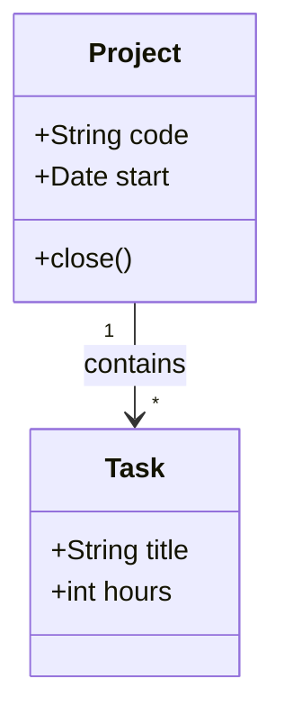

## State

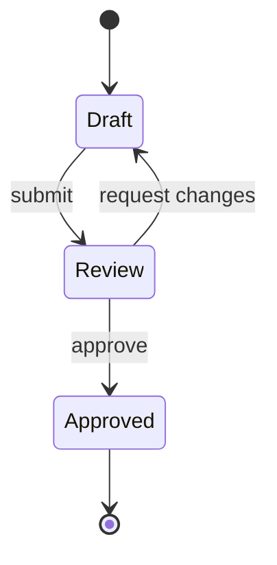

## Entity relationship

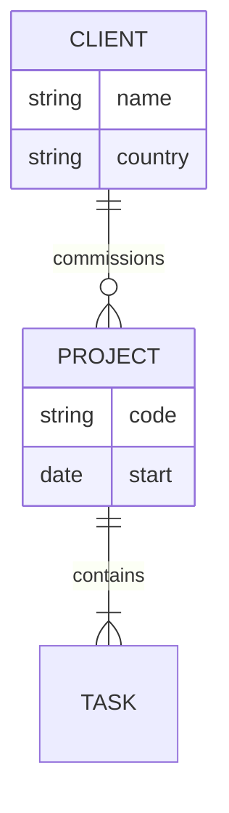

## Mind map

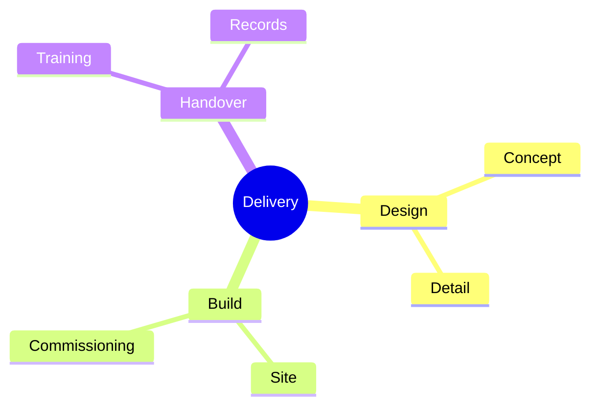

## Timeline

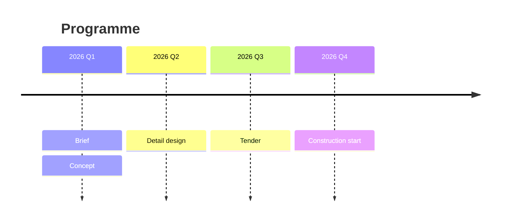

## Gantt

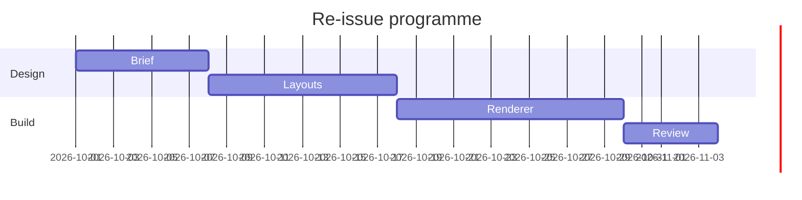

## Pie

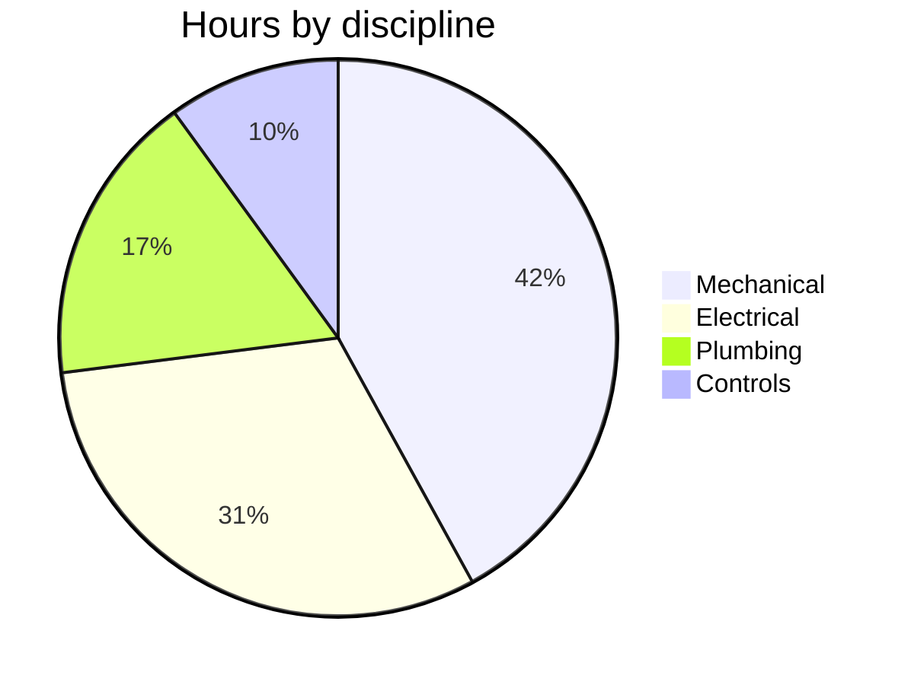

## Quadrant

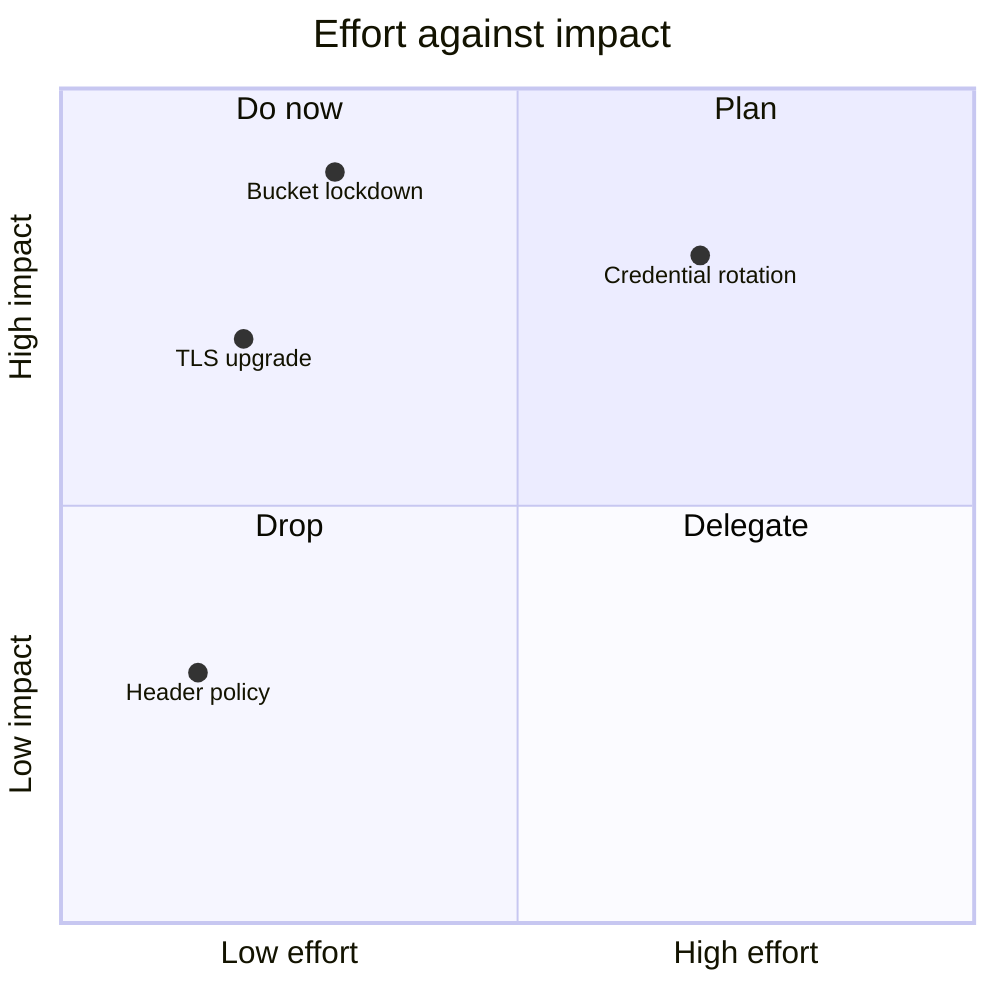

## XY chart

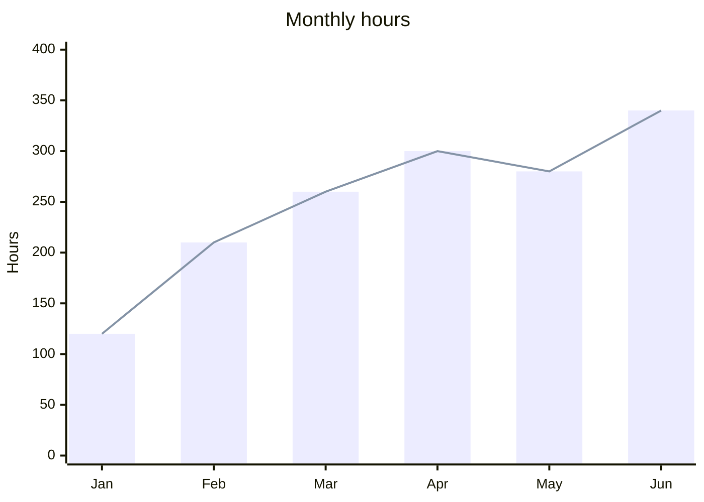

## Journey

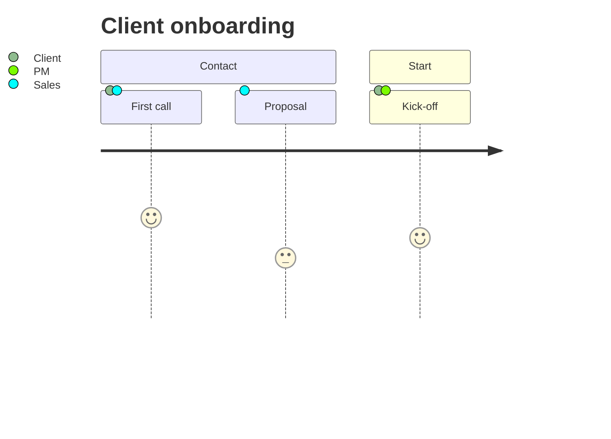

## Sankey

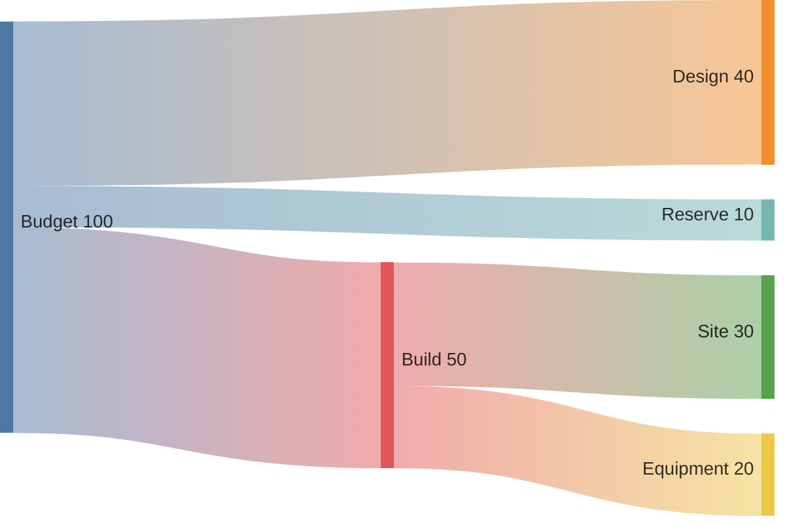

## Git graph

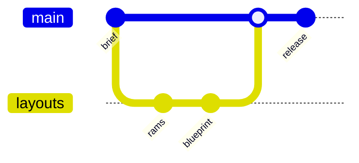

## Block

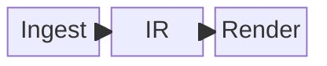

## Bar chart

```chart
bar
title Change in hours against the plan, by discipline
unit %
mark +10 Tolerance
Mechanical     +6.5
Electrical     +11.2  focus
Structural     -4.0
Architecture   -8.5
```

## Grouped bar

```chart
grouped
title Diesel and urea storage, by project
unit m³
series Diesel
series Urea (DEF)
Multi-level data centre    300  40
Expansion zone             500  30  focus
Urea distribution            -  50
```

## Dumbbell

```chart
dumbbell
title Planned and booked hours, by discipline
unit h
before Planned
after Booked
Mechanical    1,200  1,278
Electrical      860    956
Structural      640    614
```

## Waterfall

```chart
waterfall
title From planned to booked hours
unit h
axis 2,000
total Planned        2,700
step  Mechanical      +78
step  Electrical      +96  focus
step  Structural      -26
total Booked         2,848
```

## Exploded axonometric

```axonometric
exploded
title Air handling unit, exploded
part Roof panel       120 x 80 x 6
part Fan section      60 x 70 x 30  level 2  at 0 5
part Coil section     50 x 70 x 30  level 2  at 65 5  focus
part Base frame      120 x 80 x 12
```

## Axonometric plan

```axonometric
plan
title Plant room, level 1
plate 30 x 20
room  Switchroom     0  0  12 x 8
room  Plant hall    12  0  18 x 20  focus
room  Store          0  8  12 x 12
block Chiller       16  4   8 x 4  h 2.5  in Plant hall
block Pumps         16 12   6 x 3  h 1    in Plant hall
```
