# Hostile fences

Fences that found defects in review, or were written to find them: each
is headed with what it must do, and test/render/diagram-hostile.test.ts
holds it to that in a light and a dark theme. `drawn`: drawn, with no
finding. `refused: <text>`: printed as its source, the warning containing
the text. `warned: <codes>`: drawn, with exactly these findings. A defect
a review finds joins this file with its fix (CODING_STANDARDS.md).

## drawn — One row

```chart
bar
title One row
Only row 42
```

## warned: D-BUDGET — Twenty rows

```chart
bar
title Twenty rows
R01 Alpha 12
R02 Beta 15
R03 Gamma 9
R04 Delta 22
R05 Epsilon 18
R06 Zeta 7
R07 Eta 13
R08 Theta 25
R09 Iota 4
R10 Kappa 19
R11 Lambda 11
R12 Mu 16
R13 Nu 8
R14 Xi 21
R15 Omicron 14
R16 Pi 6
R17 Rho 17
R18 Sigma 10
R19 Tau 23
R20 Upsilon 5
```

## drawn — All negative

```chart
bar
title All negative
unit kEUR
Services -1,200
Management -340
Personnel -5,300 focus
```

## drawn — All equal

```chart
bar
title All equal
A 5
B 5
C 5
```

## drawn — Tick step 2.5

```chart
bar
title Tick step 2.5
A 11
B 3
```

## drawn — Before equals after

```chart
dumbbell
title Before equals after
before Plan
after Actual
Design 1,200 1,200
Build 900 1,400
```

## drawn — Decrease ending near the axis

```chart
waterfall
title Decrease ending near the axis
total Start 1,000
step Cut -980
step Back +5
total End 25
```

## drawn — A very long title that keeps going and going so that it w…

```chart
bar
title A very long title that keeps going and going so that it wraps across several lines of the column at the body size of the theme, and a Supercalifragilisticexpialidociousandthensomemorewordsjoinedtogether
Supercalifragilisticexpialidociousandthensomemore 12
Short 5
```

## warned: D-COLLIDE — Mark outside the data

```chart
bar
title Mark outside the data
mark 50 Ceiling
mark 48 Floor
A 10
B 12
```

## drawn — Mark near the middle, long label

```chart
bar
title Mark near the middle, long label
mark 49 A reference line with a long name that runs on
A 100
B 12
```

## drawn — Axis on a dumbbell, not on a step

```chart
dumbbell
title Axis on a dumbbell, not on a step
before Plan
after Actual
axis 1,950
A 2,500 2,900
B 2,100 2,200
```

## drawn — Negative values without an axis

```chart
dumbbell
title Negative values without an axis
before Plan
after Actual
Margin -5 3
Other 2 4
```

## refused: a waterfall that runs below zero is — Dips below zero

```chart
waterfall
title Dips below zero
total Start 10
step Loss -30
total End -20
```

## drawn — Eight wide values

```chart
waterfall
title Eight wide values
total Start 1,234,567.89
step Alpha +111,111.11
step Beta -222,222.22
step Gamma +333,333.33
step Delta -44,444.44
step Epsilon +55,555.55
step Zeta -66,666.66
total End 1,401,234.56
```

## drawn — Long legend names

```chart
dumbbell
title Long legend names
before The approved baseline budget from the original contract award of the project
after The forecast at completion as of the last reporting period of the year
A 10 12
```

## drawn — Values with tabular ones

```chart
bar
title Values with tabular ones
A 1,111,111
B -1,111,111
```

## drawn — Hours & "costs" <by> chapter

```chart
bar
title Hours & "costs" <by> chapter
desc Services rose; management fell & personnel held.
unit h
Services +1.8
Management -9.2 focus
```

## drawn — waterfall

```chart
waterfall
%% a comment line
total Planned 2,700
step Mechanical +78
total Booked 2,778
```

## drawn — Flow title

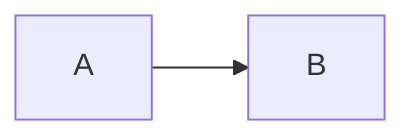

## refused: block "Desk" stands in "Hall" without saying — A block listed before room

```axonometric
plan
title A block listed before room
plate 20 x 12
block Desk 3 3 4 x 2 h 0.8
room Hall 0 0 10 x 8
room Store 10 0 10 x 8
```

## refused: two rooms are called "Hall" — Duplicate room names

```axonometric
plan
title Duplicate room names
plate 20 x 12
room Hall 0 0 10 x 8
room Hall 10 0 10 x 8
block Desk 2 2 3 x 2 h 0.8 in Hall
```

## drawn — Tall block behind short room

```axonometric
plan
title Tall block behind short room
plate 20 x 20
block Tower 0 0 4 x 4 h 6
room Office 4 4 10 x 10 h 3
block Shed 15 15 4 x 4 h 1
```

## drawn — Auto level merges

```axonometric
exploded
title Auto level merges
part A 10 x 8 x 1 level 1
part B 6 x 6 x 3
part C 10 x 8 x 1 level 2
```

## drawn — Lower in front

```axonometric
exploded
title Lower in front
gap 2
part Upper 10 x 10 x 4 at 0 0
part Lower 10 x 10 x 4 at 14 14
```

## drawn — Long labels

```axonometric
exploded
title Long labels
part Roof panel with integrated photovoltaic modules and drainage 120 x 80 x 6
part Base 120 x 80 x 12
```

## warned: D-COVER — Tiny rooms

```axonometric
plan
title Tiny rooms
plate 40 x 20
room WC 0 0 1.5 x 1.5
room Corridor connecting east wing 1.5 0 2 x 20
room Main hall 3.5 0 36.5 x 20
block Reception desk counter 30 2 4 x 2 h 1.1 in Main hall
```

## drawn — Single column

```axonometric
exploded
title Single column
part Column 2 x 2 x 60
```

## drawn — Block at front wall

```axonometric
plan
title Block at front wall
plate 12 x 12
room Lab 0 0 12 x 12 h 2.4
block Fume hood 9 9 3 x 3 h 2 in Lab
block Bench 0 9 3 x 3 h 0.9 in Lab
```

## drawn — flowchart TD

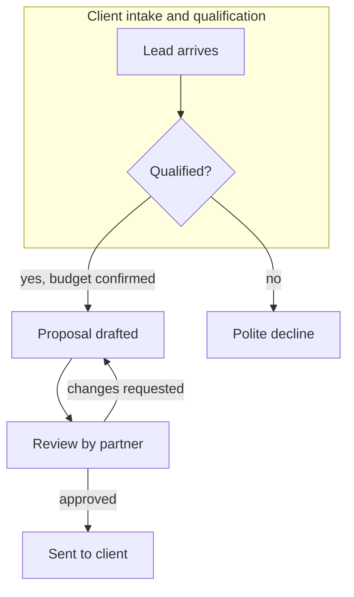

## drawn — sequenceDiagram

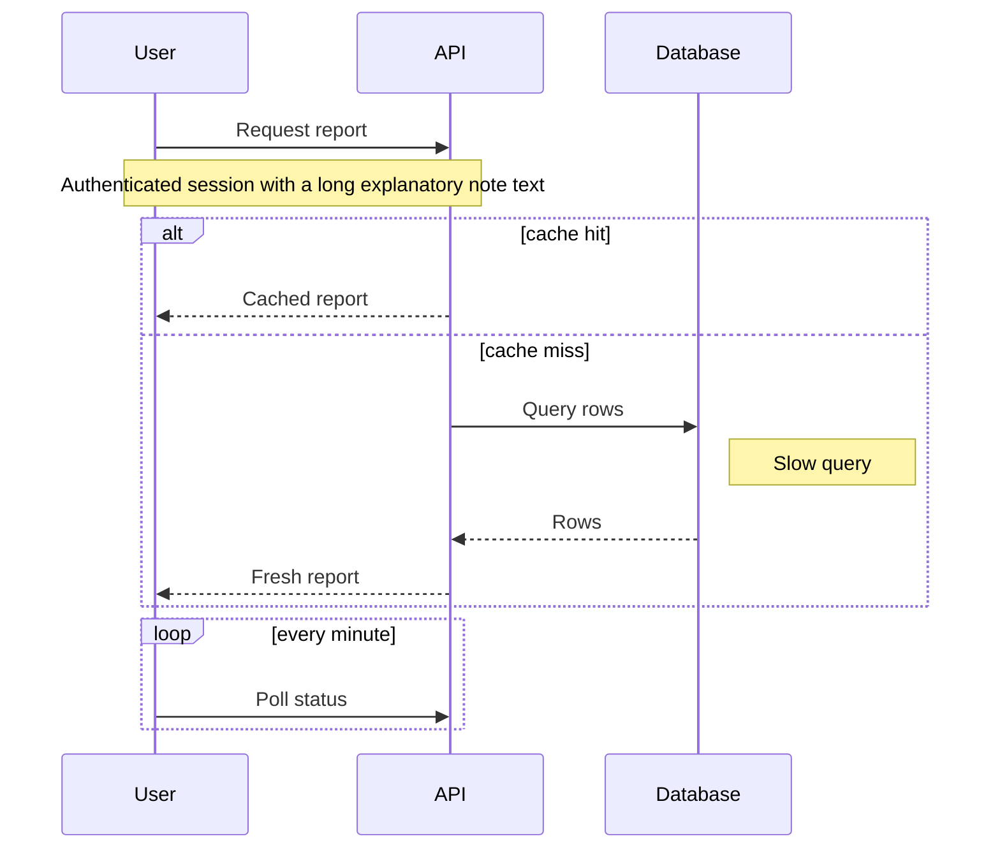

## drawn — classDiagram

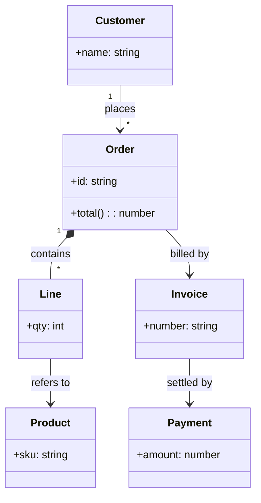

## drawn — stateDiagram-v2

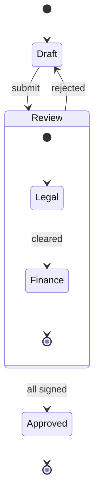

## drawn — erDiagram

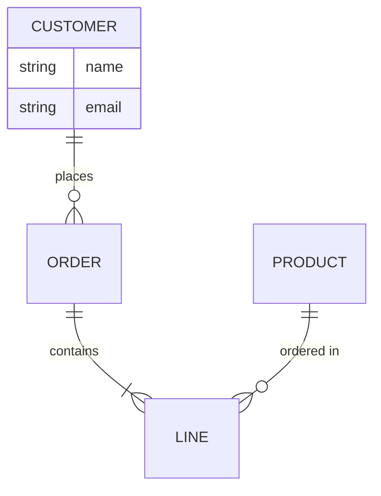

## drawn — flowchart LR

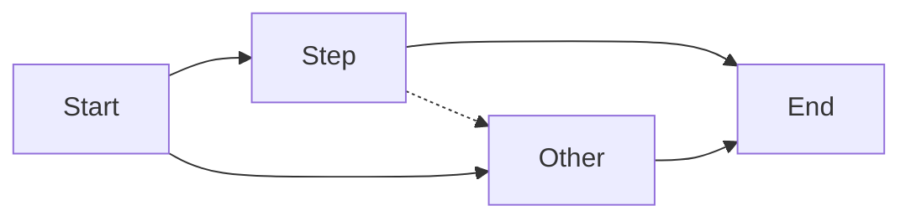

## drawn — flowchart TD

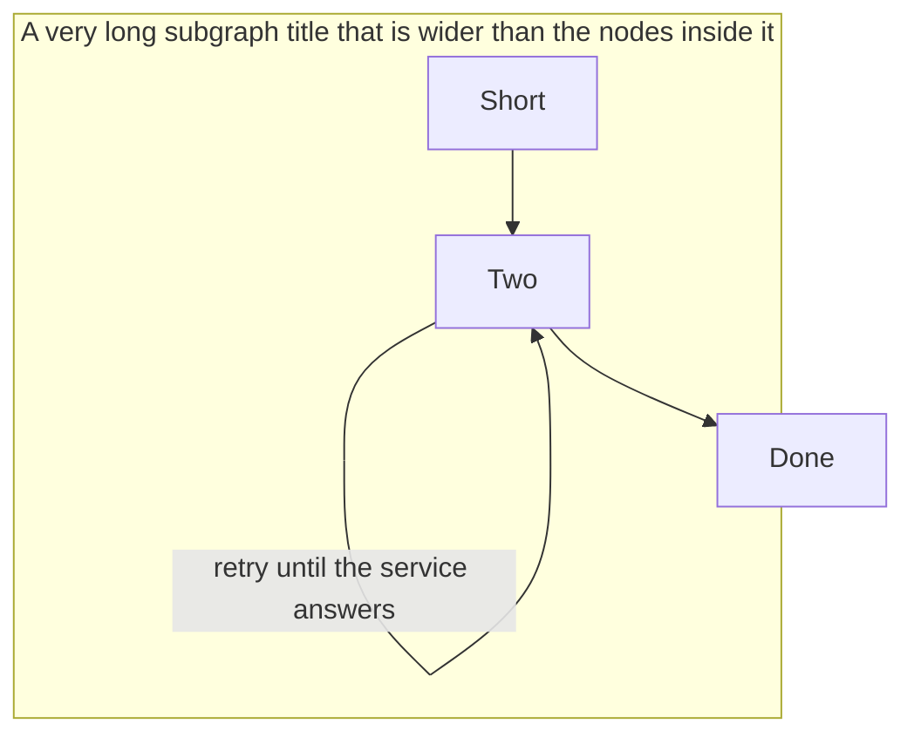

## drawn — sequenceDiagram

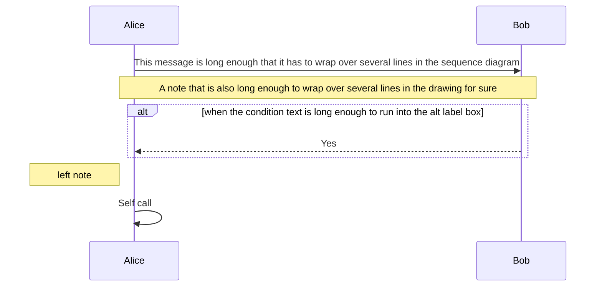

## drawn — stateDiagram-v2

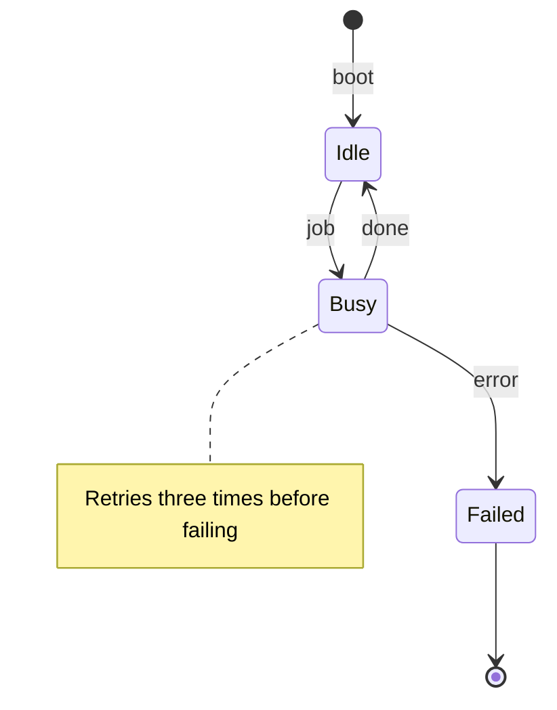

## drawn — classDiagram

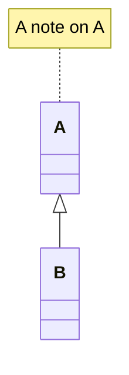

## warned: D-COLLIDE — pie title Spend

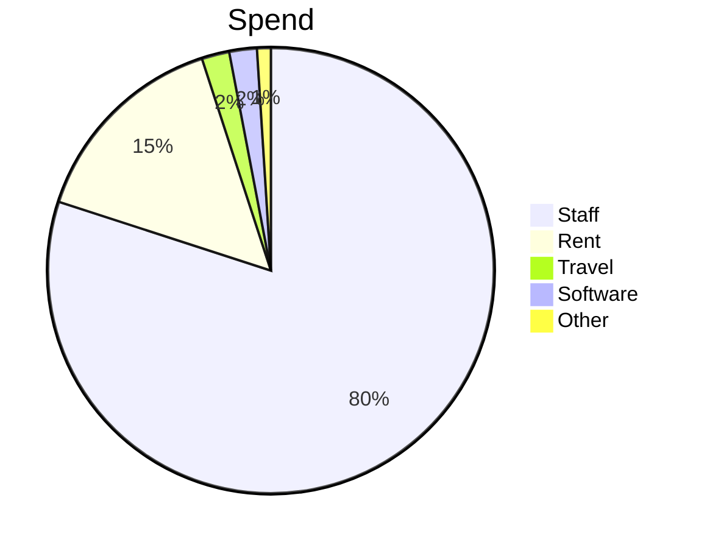

## drawn — Reach and engagement

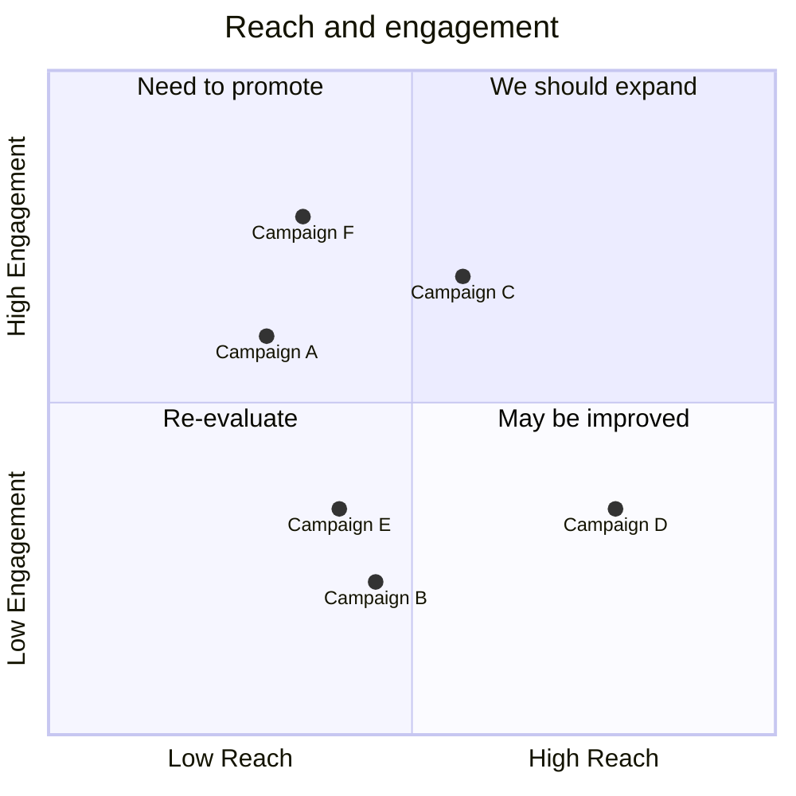

## drawn — Plan

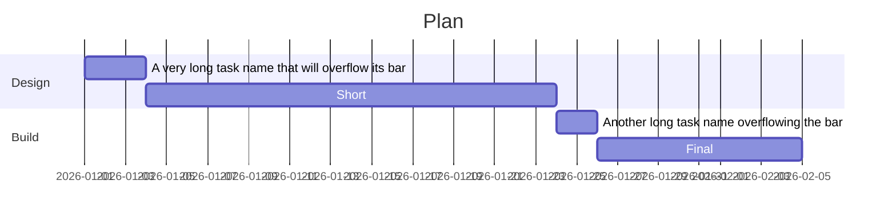

## drawn — "Monthly revenue"

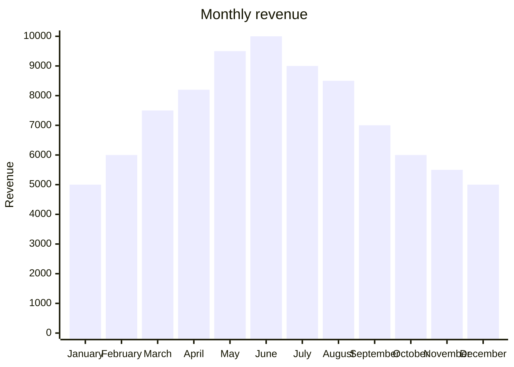

## drawn — mindmap

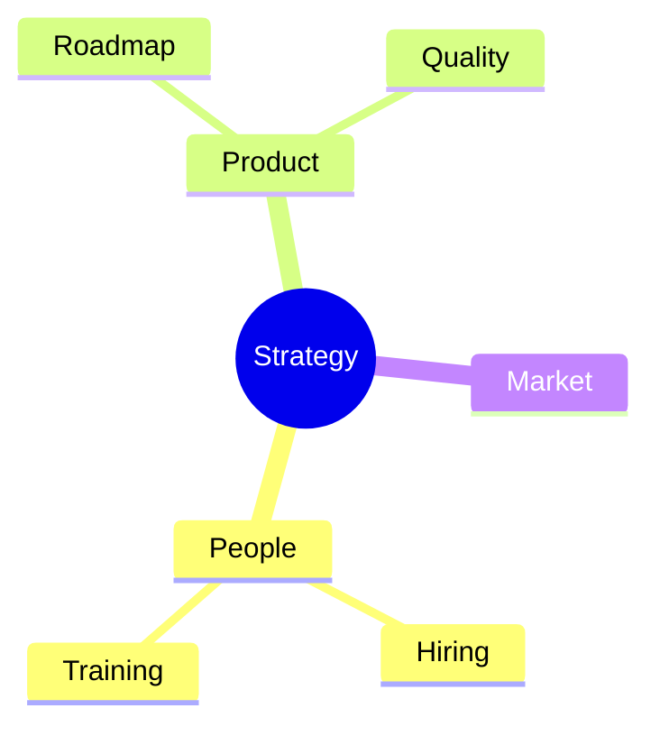

## drawn — flowchart TD

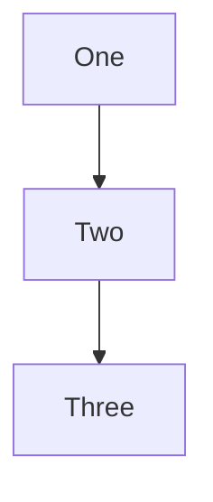

## warned: D-BUDGET, D-SMALL — flowchart LR

```mermaid
flowchart LR
  A[Collect the request] --> B[Check the scope] --> C[Estimate the effort] --> D[Draft the offer] --> E[Review internally] --> F[Send to client] --> G[Negotiate terms] --> H[Sign contract] --> I[Kick off] --> J[Deliver phase one] --> K[Deliver phase two] --> L[Invoice] --> M[Close out] --> N[Archive]
```

## warned: D-BUDGET, D-SMALL — flowchart LR

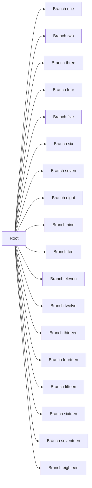

## drawn — classDiagram

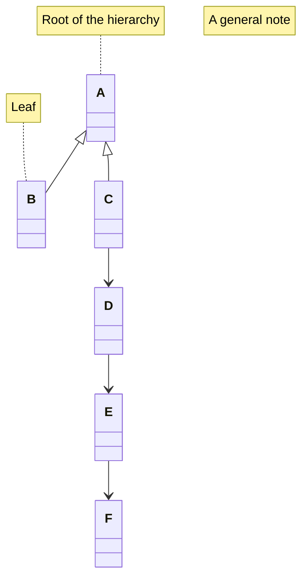

## warned: D-SMALL — stateDiagram-v2

```mermaid
stateDiagram-v2
  [*] --> S1
  S1 --> S2
  state S2 {
    [*] --> X
    X --> Y
    Y --> [*]
  }
  S2 --> S3
  state fork1 <<fork>>
  S3 --> fork1
  fork1 --> S4
  fork1 --> S5
  state c1 <<choice>>
  S4 --> c1
  c1 --> S6
  c1 --> S7
  S7 --> [*]
  note left of S1 : first
```

## warned: D-SMALL — sequenceDiagram

```mermaid
sequenceDiagram
  box Group
  participant A
  participant B
  end
  actor C
  A->>B: hi
  B->>C: hello
  create participant D
  C->>D: new
```

## drawn — erDiagram

```mermaid
erDiagram
  A ||--o{ B : has
  B ||--|{ C : has
  A ||--|| D : has
```

## drawn — classDiagram

```mermaid
classDiagram
  class Project
  class Task:::focus
  Project --> Task
  note for Task "a note"
  note "free note"
```

## drawn — stateDiagram-v2

```mermaid
stateDiagram-v2
  [*] --> Draft
  state fork1 <<fork>>
  state ch <<choice>>
  Draft --> fork1
  fork1 --> Review
  fork1 --> Check
  Review --> ch
  ch --> Done
  state Done {
    [*] --> Filed
  }
```

## drawn — erDiagram

```mermaid
erDiagram
  PROJECT ||--o{ TASK : has
  PROJECT:::focus {
    string code
    date start
  }
```

## warned: D-FOCUS — flowchart TD

```mermaid
flowchart TD
  A[Box]:::focus --> B{Decide}:::focus
  B --> C[(Store)]:::focus
  C --> D([Stadium]):::focus
  D --> E((Circle)):::focus
```
## drawn — class inheritance with labelled associations

```mermaid
classDiagram
  Animal <|-- Duck
  Animal <|-- Fish
  Animal <|-- Zebra
  Animal : +int age
  Animal : +isMammal()
  Duck : +swim()
  Fish : +swim()
  Zebra : +run()
  Duck --> Fish : eats sometimes
  Zebra "1" --> "*" Fish : ignores
```

## warned: D-CROSS — an edge through a box it does not join

```mermaid
flowchart TD
  A[Start] --> B[Check]
  B --> B
  B -->|retry| A
  B --> C[Done]
  A --> C
  A --> D[Other]
  A --> E[Third]
```

## drawn — a left-to-right flow with long labels, turned top-down

```mermaid
flowchart LR
  A[Request] --> B{Approved?}
  B -->|yes, after the second review by the steering committee| C[Order]
  B -->|no, returned to the requester with comments| D[Revise]
  D --> A
  B -->|escalate| E[Board]
  E --> C
```

## drawn — four series on a pale palette

```chart
grouped
title Four series
series A
series B
series C
series D
North 5 6 -7 8
South 3 - 4 2
```

## drawn — a grouped legend name longer than the line

```chart
grouped
series Diesel consumption in litres per month across all the construction and maintenance sites that we operate today in Europe Asia and Africa
series Urea
North 300 40
```

## drawn — years as labels

```chart
grouped
series A
series B
2023 5 6
2024 7 8
```

## refused: has no value in any row — a series with no value

```chart
grouped
series A
series B
series C
North 300 - -
South 200 - -
```

## drawn — Cyrillic labels

```chart
bar
Механіка трубопроводів шахти 1,200
Електрика 800
```
